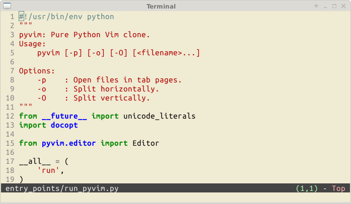

# vith (วิธ) — a fork of pyvim

**vith** (Thai: **วิธ**, from วิธี / Pali-Skt *vidhi*, "method"; also a portmanteau of **Vi**M + **TH**Ai) is a fork of [pyvim](https://github.com/prompt-toolkit/pyvim) — "an implementation of Vim in Python" originally created by Jonathan Slenders.

The upstream project was idle for several years, so this fork continues development independently. It adds **Thai & Lao script support** (terminal cell-cluster navigation and editing, two-tier word segmentation, SARA AM differential rendering) and **speed / latency / modern-Python stability** work (streamed + cached Pygments highlighting, lazy colorscheme loading, O(1) pyflakes error index, Python 3.14+/3.15 `asyncio` startup fix).

Full credit and history are preserved: Jonathan Slenders' original changelog is retained verbatim in the `CHANGELOG` appendix, and the BSD 3-clause license is retained with stacked copyright.

This fork is published as a separate PyPI package (`vith`) and is not a drop-in replacement for `pyvim`.

---

*An implementation of Vim in Python*

```sh
pip install vith
```


This fork runs on **Python 3.10+** (`prompt_toolkit` 3.0) and adds two large, machine-verified plans (documented in the `docs/` Open Knowledge bundle):

- **Thai & Lao script support**: terminal cell-cluster navigation and editing (`h`, `l`, `j`, `k`, `x`, `X`, `s`, `r`, `~`, `$`, `e`...), two-tier Thai word segmentation (`libthai` with an always-available orthographic fallback) and SARA AM (`U+0E33`/`U+0EB3`) differential renderer fixes. See [`docs/thai_support_plan.md`](docs/thai_support_plan.md).
- **Speed, latency & modern-Python stability**: streamed + cached Pygments highlighting, per-line word-span caches for Thai word motions, lazy colorscheme loading, cached word completion, an O(1) pyflakes error index, and the Python 3.14+/3.15 `asyncio` startup-crash fix. See [`docs/speed_latency_plan.md`](docs/speed_latency_plan.md).

All changes are audited in [`docs/bugs/`](docs/bugs/) (findings, each reproduced and fixed); quality is enforced with pytest, mypy and ruff.

Issues, questions, wishes, comments, feedback, remarks? Please create a GitHub issue, I appreciate it.

---

## Installation

Simply install `vith` using pip:

```sh
pip install vith
```

It is a good idea to add the following to your `~/.bashrc` if you really want to use it:

```sh
alias vi=vith
export EDITOR=vith
```

## The good things

The editor is written completely in Python. (There are no C extensions). This makes development a lot faster. It's easy to prototype and integrate new features.

We have already many nice things, for instance:

- Syntax highlighting of files, using the Pygments lexers.
- Horizontal and vertical splits, as well as tab pages. (Similar to Vim.)
- All of the functionality of [prompt_toolkit](https://github.com/prompt-toolkit/python-prompt-toolkit). This includes a lot of Vi key bindings, it's platform independent and runs every Python version covered by `python_requires >= 3.10`.
- Thai/Lao input files: cell-cluster safe navigation and *syntax-aware* word segmentation, including dictionary segmentation when `libthai` is installed.
- Several `:set ...` commands have been implemented, like `incsearch`, `number`, `ignorecase`, `wildmenu`, `expandtab`, `hlsearch`, `ruler`, `paste` and `tabstop`.
- Other working commands: `vsplit`, `tabnew`, `only`, `badd`, and many others.
- For Python source code, auto completion uses the amazing Jedi library, and code checking is done (asynchronously) through Pyflakes.
- Colorschemes can be changed at runtime.

Further, when the project develops, it should also become possible to write extensions in Python, and use Python as a scripting language. (Instead of vimscript, for instance.)

We can also do some cool stuff. Like for instance running the editor on the Python asyncio event loop and having other coroutines interact with the editor.

## Some more screenshots

Editing source code:



Window layouts (horizontal and vertical splits + tab pages):


Pyflakes for Python code checking and Jedi for autocompletion:


Other colorschemes:


Chinese and Japanese input (double width characters):


## Configuring vith

It is possible to create a `.vithrc` file for a custom configuration (with graceful fallback to `~/.pyvimrc`). Have a look at this example: [`vithrc`](examples/config/vithrc)

## Limitations

Compared to Vi Improved, Vith is still less powerful in many aspects.

- `prompt_toolkit` does not (or not yet) allow buffers to have an individual cursor when buffers are opened in several windows. Currently, this results in some unexpected behaviour, when a file is displayed in two windows at the same time. (The cursor could be displayed in the wrong window and other windows will sometimes scroll along when the cursor moves.) This has to be fixed in the future.
- The data structure for a buffer is extremely simple. (Right now, it's just a Python string, and an integer for the cursor position.) This works extremely well for development and quickly prototyping of new features.
- A lot of nice Vim features, like line folding, macros, etcetera are not yet implemented.
- Windows support is not that nice. It works, but could be improved.

## Roadmap

Pull requests and issues are welcome. Feel free to create a GitHub issue to discuss ideas or report problems.

Maybe some day we will have a better data structure (Rope), that makes it possible to open really large files. (With good algorithms, Python does not have to be slower than C code.)

Maybe we will also have line folding and probably block editing. Maybe some day we will have a built-in Python debugger or mouse support. We'll see. :)

## Testing

To run all tests, install the development requirements (pytest, mypy, ruff):

```sh
python -m pip install -r requirements-dev.txt
```

And then run from the root `vith` directory:

```sh
python -m pytest tests
```

Quality gates: `mypy .` (typing, checked against the 3.10 floor), `ruff check` (lint) and `ruff format --check .` (formatting). The reproducible measurements quoted in the docs come from:

```sh
python tools/bench_plans.py
```

## Why was PyVim originally created?

*(From Jonathan Slenders' original PyVim documentation)*:

> "The main reason is maybe because it was a small step after I created the Python `prompt-toolkit` library. That is a library which is actually only a simply pure Python readline replacement, but with some nice additions like syntax highlighting and multiline editing. It was never intended to be a toolkit for full-screen terminal applications, but at some point I realised that everything we need for an editor was in there and I liked to challenge its design. So, I started an editor and the first proof of concept was literally just a few hundred lines of code, but it was already a working editor.
>
> The creation of `pyvim` will make sure that we have a solid architecture for `prompt-toolkit`, but it also aims to demonstrate the flexibility of the library. When it makes sense, features of `pyvim` will move back to `prompt-toolkit`, which in turn also results in a better Python REPL. (see [ptpython](https://github.com/prompt-toolkit/ptpython), an alternative REPL.)
>
> Above all, it is really fun to create an editor."

## Why was the Vith fork created?

Upstream `pyvim` has been idle for several years. Vith was created to bring modern Python support and first-class Southeast Asian language capabilities to terminal-based editing:

- **Thai & Lao cell-cluster editing**: character-wise motions (`h`, `l`, `x`, `s`, `r`, `~`...) treat combining sequences as indivisible display cells, preventing dangling accents or cursor misalignment.
- **Syntax-aware word segmentation**: two-tier word boundaries combining dictionary lookup (`libthai`) with an orthographic cluster fallback.
- **Differential rendering fixes**: terminal diff-renderer updates for `SARA AM` (`U+0E33`/`U+0EB3`) and right-margin combining marks.
- **Performance & latency**: streamed Pygments syntax lexing, deferred colorscheme compilation, singleton word-completion caches, and an O(1) pyflakes error index.
- **Modern Python stability**: clean startup on Python 3.14+/3.15 asyncio event loops, PEP 621 packaging, and complete type annotations.

## Alternatives

Certainly have a look at the alternatives:

- [Kaa](https://github.com/kaaedit/kaa) by @atsuoishimoto
- [Vai](https://github.com/stefanoborini/vai) by @stefanoborini
- [Vis](https://github.com/martanne/vis) by @martanne

## Q & A

**Q: Do you use curses?**  
**A:** No, it uses only `prompt-toolkit`.

## Thanks

- To Jonathan Slenders, for creating PyVim and prompt_toolkit.
- To Vi Improved, by Bram Moolenaar, for the inspiration.
- To Jedi, pyflakes and docopt.
- To the Python wcwidth port of Jeff Quast for support of double width characters.
- To Guido van Rossum, for creating Python.
